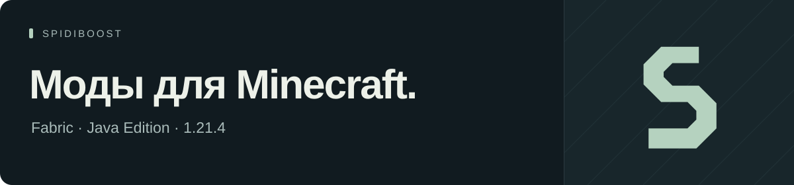

Клиентские моды от [SpidiBoost](https://github.com/SpidiBoostDev). Инструменты для ReallyWorld и небольшие дополнения к игре.

### Выбрать мод

| Мод | Для чего | Скачать |
| :--- | :--- | :--- |
| **[6ubaaFP](https://github.com/SpidiBoostMods/6ubaaFP)** | Проверки игроков, инвентарей и регионов. AutoRG, баланс и журнал банов. | [Последний релиз](https://github.com/SpidiBoostMods/6ubaaFP/releases/latest) |
| **[SpidiCard](https://github.com/SpidiBoostMods/SpidiCard)** | Поиск ключ-карт в инвентарях игроков. | [Последний релиз](https://github.com/SpidiBoostMods/SpidiCard/releases/latest) |
| **[SpidiBan](https://github.com/SpidiBoostMods/SpidiBan)** | Списки игроков, выдача банов и проверка истории наказаний. | [Последний релиз](https://github.com/SpidiBoostMods/SpidiBan/releases/latest) |
| **[MuhaShist](https://github.com/SpidiBoostMods/MuhaShist)** | Подсчёт качественных банов по истории ReallyWorld. Исходники открыты. | [Последний релиз](https://github.com/SpidiBoostMods/MuhaShist/releases/latest) |
| **[LittlePet](https://github.com/SpidiBoostMods/LittlePet)** | Клиентские питомцы. | [Последний релиз](https://github.com/SpidiBoostMods/LittlePet/releases/latest) |

**SpidiCard и 6ubaaFP требуют подписку.** Вопросы по доступу — [в VK](https://vk.ru/paveljaparov).

### Установка

Minecraft **1.21.4**, **Fabric**, **Fabric API** и **Java 21**. Скачай `.jar` из релиза выбранного мода и положи в папку `mods` своего инстанса. Команды и настройки описаны в его README.

### Помощь

Нашёл ошибку — открой Issues в репозитории мода. Укажи версии Minecraft и мода, опиши шаги и приложи лог или скриншот. Перед отправкой лога убери личные данные.

По подпискам и другим вопросам — **[написать SpidiBoost](https://vk.ru/paveljaparov)**.
